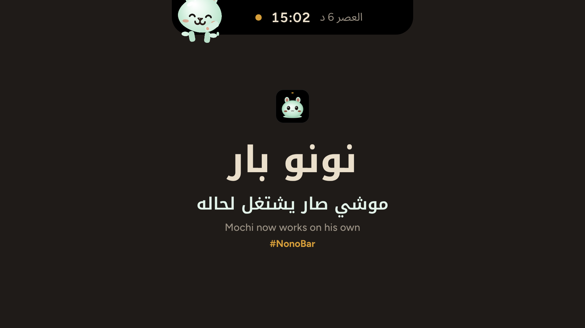
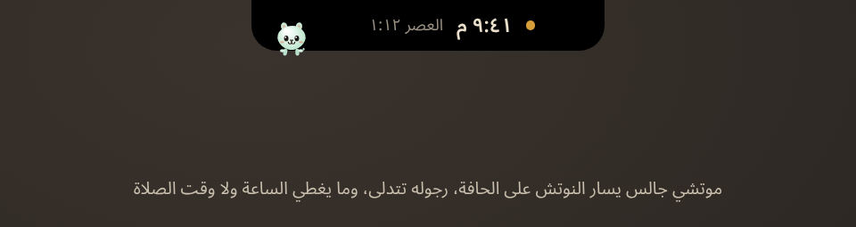
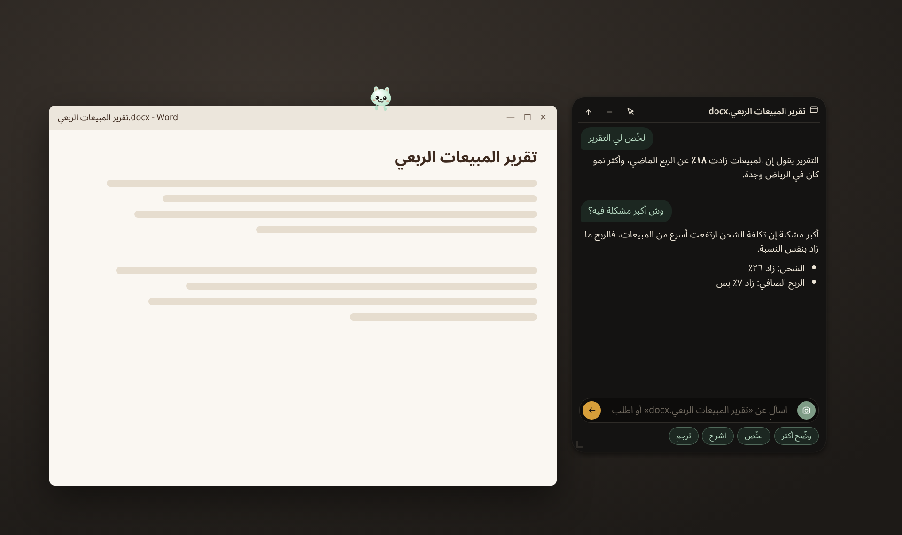

<p align="center"></p>

# نونو بار · Nono Bar

**[العربية](#العربية) · [English](#english)**

> برنامج مجاني لويندوز. الكود مغلق، والتحميل من قسم [الإصدارات](../../releases/latest) فقط.
> Free Windows app. Closed source. Download from [Releases](../../releases/latest) only.

---

## العربية

نونو بار نوتش أسود صغير أعلى شاشة ويندوز، معه **موتشي**: صاحبك الصغير اللي تحطه على أي نافذة ويساعدك فيها بالذكاء الاصطناعي.

<p align="center"></p>

### المميزات
- **النوتش:** مرّر الماوس عليه أو اضغط <kbd>Alt</kbd>+<kbd>N</kbd>. وهو مسكّر يوريك الساعة والصلاة الجاية.
- **التاريخ والصلاة:** التاريخ الهجري (أم القرى) ومواقيت الصلاة، والطقس، والتذكيرات.
- **الوسائط:** اللي يشتغل الحين مع أزرار التحكم.
- **المهام:** قائمة مهام مع تذكير، وتقدر تخلي موتشي يشتغل على المهمة في وقتها.
- **موتشي:** اسحبه وحطه على أي نافذة (Word، المتصفح، مجلد…) واسأله عنها: يلخّص، يشرح، يترجم، ويعدّل الملفات بعد موافقتك مع نسخة احتياطية وزر تراجع.
- **محادثة جماعية:** من ٢ إلى ٤ موتشي، كل واحد بمزوده.
- **عربي وإنجليزي** مع دعم كامل للاتجاه من اليمين لليسار.
- **تحديث بضغطة وحدة:** إذا نزلت نسخة جديدة يطلع لك زر «تحديث»، تضغطه ويتحمّل ويتثبّت ويرجع يشتغل.

<p align="center"></p>

### التثبيت
1. افتح [آخر إصدار](../../releases/latest) وحمّل `NonoBar_<الإصدار>_x64-setup.exe`.
2. شغّل الملف. التثبيت للمستخدم الحالي فقط وما يحتاج صلاحيات مدير.
3. يطلع النوتش أعلى الشاشة. افتح الإعدادات ثم «الذكاء الاصطناعي» واختر مزودك.

النسخة المحمولة `NonoBar_<الإصدار>_x64-portable.exe` تشتغل بدون تثبيت (تحتاج WebView2، وهو موجود في ويندوز ١١).

**يحتاج:** ويندوز ١٠ أو ١١، ٦٤ بت.

### تنبيه SmartScreen
البرنامج ما عليه توقيع شهادة Authenticode للحين، فممكن ويندوز يقول «Windows protected your PC». اضغط **More info** ثم **Run anyway**. قبلها تأكد من بصمة الملف (تحت).

### التأكد من سلامة الملف (SHA256)
في PowerShell:
```powershell
Get-FileHash .\NonoBar_0.4.2_x64-setup.exe -Algorithm SHA256
```
لازم الناتج يطابق السطر نفسه في `SHA256SUMS.txt` المرفق مع الإصدار. لو ما طابق لا تشغّل الملف.

### التحديثات
البرنامج يتحقق من هذا المستودع عند التشغيل وكل ٦ ساعات. التحديث موقّع، والبرنامج يتأكد من التوقيع قبل التثبيت، ولو التوقيع غلط يرفضه. تقدر تطفي التحقق من الإعدادات ثم «التحديثات والخصوصية».

### الخصوصية
- كل شي يشتغل على جهازك. ما فيه حساب ولا تتبع ولا Telemetry.
- تستخدم اشتراكك أو مفتاحك أنت (ChatGPT، Claude، Grok، Gemini، OpenAI، أو Ollama محلي). المفاتيح تنحفظ مشفرة بـ Windows DPAPI على جهازك.
- اللي يطلع من جهازك: اللي ترسله أنت لمزود الذكاء الاصطناعي اللي اخترته، والطقس من Open-Meteo، والتحقق من التحديثات من GitHub.

### الرخصة
مجاني للاستخدام الشخصي والتجاري. ممنوع البيع أو التعديل أو الهندسة العكسية. التفاصيل في [LICENSE](LICENSE).

---

## English

Nono Bar adds a small black notch to the top of your Windows screen, with **Mochi**: a little companion you drop on any window to get AI help with it.

### Features
- **Notch:** hover it or press <kbd>Alt</kbd>+<kbd>N</kbd>. Closed, it shows the clock and the next prayer.
- **Dates and prayer:** Hijri date (Umm al-Qura), prayer times, weather, reminders.
- **Media:** now playing, with controls.
- **Todos:** a todo list with reminders; Mochi can work on a task when it is due.
- **Mochi:** drag it onto any window (Word, a browser, a folder…) and ask about it: summarize, explain, translate, and edit files after you approve, with a backup and Undo.
- **Group chat:** 2 to 4 Mochis, each on its own provider.
- **Arabic and English**, full RTL support.
- **One-click updates:** when a new version is out, an «Update» button shows up. Click it and Nono Bar downloads, installs and restarts.

### Install
1. Open the [latest release](../../releases/latest) and download `NonoBar_<version>_x64-setup.exe`.
2. Run it. It installs for the current user only and needs no admin rights.
3. The notch appears at the top of the screen. Open Settings > AI and pick your provider.

The portable `NonoBar_<version>_x64-portable.exe` runs without installing (needs WebView2, built into Windows 11).

**Requires:** Windows 10 or 11, 64-bit.

### SmartScreen
The app is not Authenticode-signed yet, so Windows may show "Windows protected your PC". Click **More info**, then **Run anyway**. Check the file hash first (below).

### Verify the download (SHA256)
In PowerShell:
```powershell
Get-FileHash .\NonoBar_0.4.2_x64-setup.exe -Algorithm SHA256
```
The hash must match the line in `SHA256SUMS.txt` attached to the release. If it does not match, do not run the file.

### Updates
Nono Bar checks this repository at startup and every 6 hours. Updates are signed, and the app verifies the signature before installing; a bad signature is refused. You can turn checks off in Settings > Updates & privacy.

### Privacy
- Everything runs on your PC. No account, no tracking, no telemetry.
- You bring your own AI subscription or API key (ChatGPT, Claude, Grok, Gemini, OpenAI, or local Ollama). Keys are stored encrypted with Windows DPAPI on your PC.
- What leaves your PC: what you send to the AI provider you picked, weather from Open-Meteo, and update checks against GitHub.

### License
Free for personal and commercial use. No selling, no modification, no reverse engineering. See [LICENSE](LICENSE).

---

© 2026 Cut_code

للتواصل / Contact: [willy.Nilly0085@gmail.com](mailto:willy.Nilly0085@gmail.com) · X: [@Cut_Code](https://x.com/Cut_Code)
